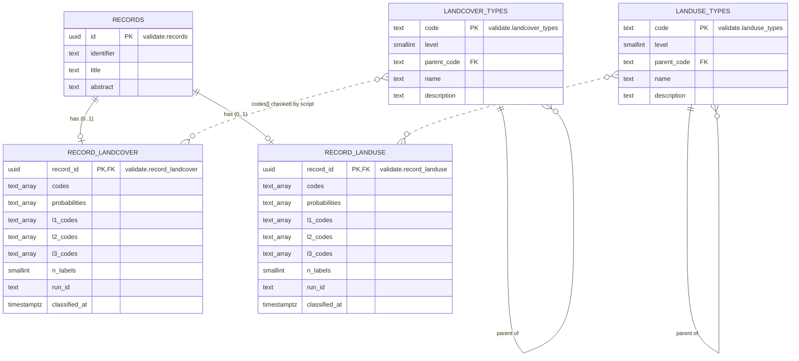

# Plan: load classification results into the database

Status: **implemented** with the defaults for the open questions in section 6: `landclass/dbload.py`, `load_to_db.py`, `pipeline.py`, `run_all.sh`. `validate` turned out to be an existing schema that holds its own `records` table, so the foreign key points to `validate.records` (set by `DB_SCHEMA` / `DB_TABLE` in `.env`). Descriptions are empty until `type_descriptions.csv` (taxonomy, code, description) is provided.

## 1. Goal

Today the classifier only reads `validate.records` (the table named by `DB_SCHEMA`.`DB_TABLE`) and writes CSV files. Add a script that loads the
result CSVs into new PostgreSQL tables in a separate schema, `validate`. There will be **4 new tables**:

| Table | Purpose |
|---|---|
| `validate.landcover_types` | lookup: every land cover class (id, name, description) |
| `validate.landuse_types` | lookup: every land use class (id, name, description) |
| `validate.record_landcover` | land cover result per record |
| `validate.record_landuse` | land use result per record |

The two result tables use `records.id` as their primary key and as a foreign key to `validate.records` (the table named by `DB_SCHEMA`.`DB_TABLE`).
Only the `validate` schema is written to.

## 2. Decisions taken from your answers

| # | Decision |
|---|---|
| Q1 | Load the wide `*_results.csv` files (one row per record), for land cover and land use. `*_scores_long.csv` is not loaded. |
| Q2 | New tables go in the `validate` schema, not `public`. Two extra lookup tables hold the class code, name and description (from the LUCAS website). |
| Q3 | Multi-value columns are stored as `text[]` arrays. |
| Q4 | **No history.** You said "keep it if you think we need that". A primary key of `record_id` allows only one row per record, which is what you asked for, and `run_id` records which run the row came from. If you later want history, it is a separate table. |
| Q5 | The script creates the tables (`CREATE ... IF NOT EXISTS`). |
| Q6 | Records with `n_labels = 0` are skipped. They get no row. |
| Q7 | The abstract is not stored. |
| Q8 | No action needed. See the explanation in section 7. |
| Q9 | Same database as `records`. The foreign key points from `validate.*` to `validate.records(id)`, and the script checks that the schema and the key exist. |
| Q10 | `ON DELETE CASCADE`. |
| Q11 | Explained in section 7. Default: only `run_id` is stored. |

## 3. Tables

### 3.1 Lookup tables (`landcover_types`, `landuse_types`)

The same structure for both. One row per class at every level, built from `LandCover_Types.csv` and
`LandUse_Types.csv` (3 levels each).

| Column | Type | Notes |
|---|---|---|
| `code` | `text` | **PK**, e.g. `B17`, `A10`, `U1` |
| `level` | `smallint` | 1, 2 or 3 (`CHECK` between 1 and 3) |
| `parent_code` | `text` | FK to the same table, `NULL` at level 1 |
| `name` | `text` | `NOT NULL` |
| `description` | `text` | long description from the LUCAS website, can be `NULL` |

The CSV files only hold the short names. The descriptions have to come from the LUCAS documentation,
so they need a one-time import (see Q-A below).

### 3.2 Result tables (`record_landcover`, `record_landuse`)

The same columns in both. The relation to `records` is **one to one**: a record has at most one row
per table.

| Column | Type | Notes |
|---|---|---|
| `record_id` | `uuid` | **PK**, FK to `validate.records(id)`, `ON DELETE CASCADE` |
| `codes` | `text[]` | deepest classes, e.g. `{B17,C}` |
| `probabilities` | `text[]` | same order as `codes`, e.g. `{B17=0.98,C=0.71}` |
| `l1_codes` | `text[]` | selected Level 1 classes |
| `l2_codes` | `text[]` | selected Level 2 classes |
| `l3_codes` | `text[]` | selected Level 3 classes |
| `n_labels` | `smallint` | always 1 or more, because empty results are skipped |
| `run_id` | `text` | run the row came from, e.g. `20261007-153952` |
| `classified_at` | `timestamptz` | set when the row is loaded |

Changes from the first draft:
- The `*_labels` columns are dropped. The names are now in the lookup tables, so storing them again
  would duplicate data. A query can join `codes` to `*_types.name` instead. Say so if you want them back.
- `id`, `identifier` and `title` are not stored. They live in `records`.

Postgres cannot put a foreign key on array elements, so the script checks every code against the
lookup table before loading. A row with an unknown code is rejected and reported.

## 4. ERD



Solid lines are real foreign keys. The dotted lines are links that the script validates, because a
foreign key cannot point from array elements. `records` may have more columns than shown. Only the
ones the classifier reads are drawn.

```drawio width=800
<mxfile>
  <diagram id="default" name="Page-1">
    <mxGraphModel>
      <root>
        <mxCell id="0"/>
        <mxCell id="1" parent="0"/>
      </root>
    </mxGraphModel>
  </diagram>
</mxfile>
```


## 5. The scripts

Files: `sql/create_tables.sql` (DDL), `landclass/dbload.py` (logic), `load_to_db.py` (CLI).

```bash
.venv/bin/python load_to_db.py types                           # create tables, load the class lookup tables
.venv/bin/python load_to_db.py results output/<run_id>         # load land cover + land use results
.venv/bin/python load_to_db.py results output/<run_id> --taxonomy landuse
.venv/bin/python load_to_db.py results output/<run_id> --dry-run   # validate only, no writes
```

`types` step:
1. Create the `validate` schema and the four tables if they do not exist.
2. Read `LandCover_Types.csv` and `LandUse_Types.csv`, flatten the three levels into one row per class
   (code, level, parent, name), and upsert them. Descriptions come from the LUCAS import (Q-A).

`results` step:
1. Read the DB settings from `.env` (same keys as the existing fetch).
2. Read the CSV with `dtype=str` and `keep_default_na=False`.
3. Skip rows with `n_labels = 0`, and count them.
4. Split `"A; F"` strings into arrays.
5. Validate: required columns present, no duplicate `id`, every `id` exists in `validate.records` (the table named by `DB_SCHEMA`.`DB_TABLE`),
   every code exists in the lookup table. Bad rows are reported and skipped.
6. Upsert in batches (`INSERT ... ON CONFLICT (record_id) DO UPDATE`) in **one transaction**, so a failure
   leaves the table unchanged.
7. Print a summary: read, skipped (no label), skipped (invalid, with reasons), inserted, updated.

Re-running is safe. A newer run overwrites the older row for the same record.

`psycopg2` is already in `requirements.txt`, so there are no new dependencies. README and `data.py`
currently say "the database is only read". That changes, and the README text has to be updated. The
writes go only to the `validate` schema and never touch `records`.

## 6. Questions to confirm

- **Q-A. Descriptions.** Where exactly should the descriptions come from? The project CSVs hold short
  names only. I would take them from the official LUCAS land cover and land use classification
  documents (Eurostat). Do you have a link or a file, or should I find them? Without an answer, I
  create the column empty and fill it later.
- **Q-B. Schema name.** I read "validate" as the name of a Postgres schema, `validate`, that the script
  creates. Is that right, or do you mean a temporary test schema, with `public` later?
- **Q-C. Labels.** OK to drop the `*_labels` columns (names come from the lookup tables)?
- **Q-D. Land use hierarchy.** The `landuse_types` table uses `U1`-style codes from `LandUse_Types.csv`
  (HILUCS-like), while "the LUCAS website" has its own land use codes. Should the table follow the CSV
  (matches the classifier output) or the website? I assume the CSV, because the results use those
  codes.

## 7. Your answers (kept as written) and explanations

1. use csv which has result for the lu and lc.
2. no only in validate for now. and make another table for Land cover and land use give them id and name and discription from lucus website so there will be 4 new tables.
3. yes
4. keep it if you think we need that
5. yeah create tables
6. skip thme
7. yes
8. didnt understand it
9. yes validate schema
10. yes yes sure use Cascade
11. explain it

**Q8, explained.** It only asks which database software you use. SQL differs a little between
PostgreSQL, MySQL and SQLite. The project already connects with `psycopg2`, which is a PostgreSQL
driver, so it is PostgreSQL and I will write PostgreSQL SQL. You do not need to do anything.

**Q11, explained.** Besides the class codes, each classification run has other details that I could
save with every row: the model name (for example `mistral-small-latest`), the thresholds used to turn
probabilities into labels (for example 0.60 / 0.50 / 0.50 for the three levels), and the gate score for
land use. They tell you later how a label was produced. Right now they sit in
`output/<run_id>/*_thresholds.txt`, not in the CSV, so storing them costs extra work. I would store
only `run_id`, so you can find the run and its files when needed. Tell me if you want the thresholds or
the model name stored as well.
